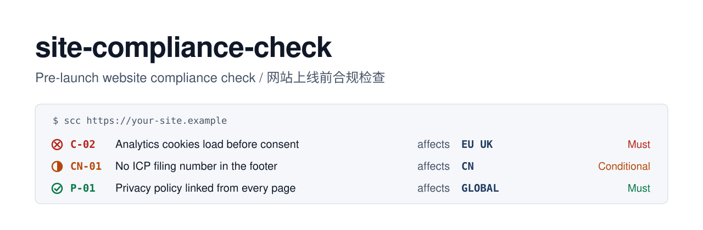
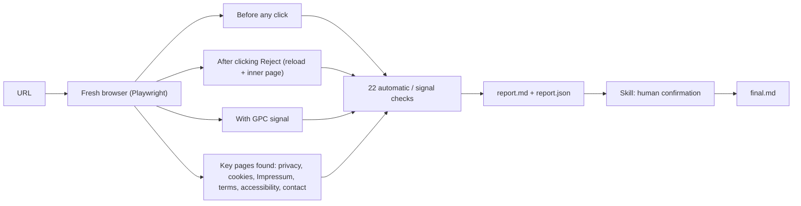

<p align="center">
  <picture>
    <source media="(prefers-color-scheme: dark)" srcset="docs/assets/banner-dark.svg">
    
  </picture>
</p>

<p align="center">
  <a href="https://github.com/itsgavinwayne/site-compliance-check/releases"></a>
  <a href="LICENSE"></a>
  
  
</p>

<p align="center"><b>English</b> | <a href="README.zh-CN.md">简体中文</a></p>

Give it a URL. It tells you what the site is missing for privacy, consent, business-disclosure and accessibility rules, which markets each gap affects, and how serious it is. You don't declare a target market first: every finding names the markets it affects, so the reader decides what applies. It checks compliance only — not SEO, performance, security, or how to implement fixes.

## Install with one prompt

Paste this into Claude Code. Claude clones the repo, installs dependencies (Node 20+ required), and links the skill.

```text
Install the site-compliance-check skill for me: clone https://github.com/itsgavinwayne/site-compliance-check into ~/.claude/site-compliance-check (git pull if it already exists), run `npm install` and `npx playwright install chromium` inside its scanner/ folder, then symlink ~/.claude/site-compliance-check/skill/site-compliance-check to ~/.claude/skills/site-compliance-check. Tell me when it's ready.
```

### Then ask

Start a new Claude Code session and say one of these:

- `Run a compliance check on https://example.com`
- `Is example.com GDPR and cookie compliant?`
- `查一下 https://example.com 的合规`

The skill runs the scanner, explains failures from Must to Conditional to Recommended with the markets they affect, and walks you through the items that need a human to confirm. It writes `reports/<host>-<date>/final.md`, where each line says whether the conclusion came from the scanner, from your confirmation, or is still unconfirmed. Reports stay local (`reports/` is git-ignored).

To update, ask Claude to "update the site-compliance-check skill" (it runs `git pull` in `~/.claude/site-compliance-check`).

## What a report looks like

Reports are currently written in Chinese. The sample keeps the original output.

```text
- 结果：❌ 不通过 7 ｜ 🔍 需人工 19 ｜ ⚠️ 出错 0 ｜ ✅ 通过 8 ｜ ➖ 不适用 3
✅ C-02 通过：同意前未发现已知追踪 Cookie 或请求（共 16 个请求、1 个 Cookie） → 影响 EU UK ｜ 必须
✅ C-03 通过：横幅按钮：Accept additional cookies[accept]、Reject additional cookies[reject] → 影响 EU UK ｜ 必须
❌ C-09 没有 "Do Not Sell or Share My Personal Information" 链接 → 影响 US ｜ 视情况（适用条件：达到加州等州隐私法的营收或数据量门槛）
❌ I-03 没有 Impressum（运营者信息页） → 影响 DE AT ｜ 视情况（适用条件：运营方在德国/奥地利设立，或面向德奥用户提供商业性数字服务）
```

Full sample reports for a public site: [www.gov.uk report](examples/www.gov.uk/report.md) and [example.com report](examples/example.com/report.md).

| Status | Meaning |
|---|---|
| ✅ | Pass |
| ❌ | Fail |
| 🔍 | Needs human confirmation |
| ⚠️ | Check errored (never counted as a pass) |
| ➖ | Not applicable |

## What it checks

37 rules in [rules/registry.yaml](rules/registry.yaml), each with an official legal source and a verification date, split into 14 automatic checks, 8 scanner signals for human confirmation, and 15 manual checklist items; levels are 21 Must, 13 Conditional (each states its condition), and 3 Recommended.

| Category | Rules | GLOBAL | EU | UK | US | CN | DE | AT | CH | KR | JP | CA |
|---|---|---|---|---|---|---|---|---|---|---|---|---|
| Privacy policy | 10 | 2 | 6 | 6 | 3 | 6 | | | 2 | 5 | | 2 |
| Cookies and tracking | 11 | | 8 | 8 | 2 | | | | | | 1 | |
| Forms and marketing | 5 | 2 | 3 | 3 | 1 | 2 | | | | 1 | | |
| Business disclosure (Impressum etc.) | 4 | 1 | 1 | 1 | | | 1 | 1 | | | | |
| China (ICP / PSB filing, PIPL) | 4 | | | | | 4 | | | | | | |
| Accessibility | 2 | | 2 | | 1 | | | | | | | |
| Asset licensing | 1 | 1 | | | | | | | | | | |

See [docs/checklist.md](docs/checklist.md) for a printable checklist generated from the registry, and [docs/rules/](docs/rules/README.md) for per-category rationale and sources.

## How it works



## Use the scanner directly

Requires Node 20+.

```bash
git clone https://github.com/itsgavinwayne/site-compliance-check.git
```

```bash
cd site-compliance-check/scanner
```

```bash
npm install
```

```bash
npx playwright install chromium
```

```bash
node bin/scc.js https://example.com --out ../reports/example.com
```

Options:

| Option | Description |
|---|---|
| `--out <dir>` | Write report.md, report.json, and screenshots. |
| `--json` | Print JSON to stdout. |
| `--timeout <ms>` | Page timeout. Raise it for slow or far-away sites. |
| `--settle <ms>` | Extra wait after network idle. |
| `--no-axe` | Skip the axe accessibility scan. A-01 then shows as errored, not passed. |

To install the skill by hand instead of with a prompt, see [skill/README.md](skill/README.md).

## Limitations

- Automation covers only part of the requirements; axe finds only part of WCAG issues.
- Scans the home page plus discovered key pages, not the whole site.
- Recognizes trackers from a known list in `scanner/src/trackers.js`.
- Custom cookie banners may not be detected and are marked for human confirmation.
- Results reflect the network you scan from: geo-targeted banners can differ, and slow mainland-China sites can time out and show as errored.
- Some legal sources are still awaiting manual verification. See [docs/rules/README.md](docs/rules/README.md).

## Contributing

Rules live in [rules/registry.yaml](rules/registry.yaml) (fields in [rules/SCHEMA.md](rules/SCHEMA.md)); after editing, run the commands below. Every rule needs an official source and a verification date.

```bash
node scripts/gen-checklist.js
```

```bash
cd scanner && npm test
```

## Disclaimer and license

This tool is not legal advice and does not guarantee compliance. Results reflect the site at scan time and the rules in the registry. Consult a lawyer before launch.

License: MIT. See [LICENSE](LICENSE).
