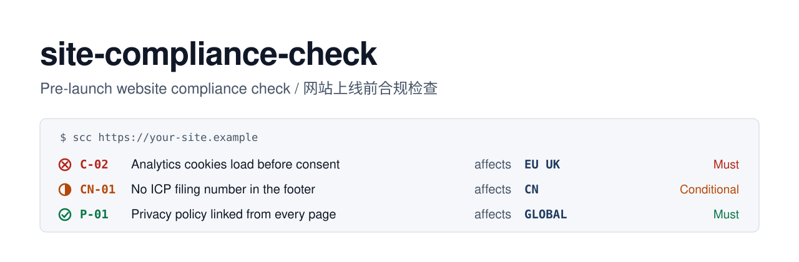
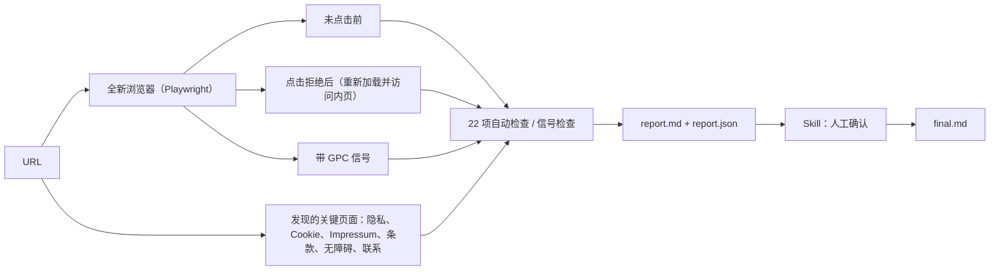

<p align="center">
  <picture>
    <source media="(prefers-color-scheme: dark)" srcset="docs/assets/banner-dark.svg">
    
  </picture>
</p>

<p align="center">
  <a href="https://github.com/itsgavinwayne/site-compliance-check/releases"></a>
  <a href="LICENSE"></a>
  
  
</p>

<p align="center"><a href="README.md">English</a> | <b>简体中文</b></p>

给它一个网址，它会告诉你：这个站在隐私、Cookie 同意、公示信息、无障碍等合规要求上缺了什么，每一项影响哪些市场，严重程度如何。你不需要先声明目标市场：每条发现都会列出受影响的市场，由你判断哪些适用。它只检查合规，不检查 SEO、性能、安全，也不说明如何实现修复。

## 用一句提示词安装

把下面这段提示词粘贴到 Claude Code；Claude 会克隆仓库、安装依赖（需要 Node 20+），并链接 skill。

```text
帮我安装 site-compliance-check skill：
1. 把 https://github.com/itsgavinwayne/site-compliance-check
   克隆到 ~/.claude/site-compliance-check（已存在就 git pull）
2. 在它的 scanner/ 目录里运行 npm install
   和 npx playwright install chromium
3. 把 ~/.claude/site-compliance-check/skill/site-compliance-check
   软链接到 ~/.claude/skills/site-compliance-check
装好后告诉我。
```

### 然后问

新开一个 Claude Code 会话，说其中一句：

- `查一下 https://example.com 的合规`
- `这个站上线前做个合规检查：example.com`
- `Run a compliance check on https://example.com`

这个 skill 会运行扫描器，按必须、视情况、建议的顺序讲解不通过的项及其影响的市场，带你确认需要人工判断的项目，并写出 `reports/<host>-<date>/final.md`；文件中的每一行都会注明结论来自扫描器、来自你的确认，还是仍未确认。报告保存在本地（`reports/` 已被 git 忽略）。

更新：对 Claude 说“更新 site-compliance-check skill”（它会在 `~/.claude/site-compliance-check` 中运行 git pull）。

## 报告长什么样

报告先给出总体结果，再逐条列出发现。下面是输出片段（工具的输出语言为中文）：

```text
- 结果：❌ 不通过 7 ｜ 🔍 需人工 19 ｜ ⚠️ 出错 0 ｜ ✅ 通过 8 ｜ ➖ 不适用 3
✅ C-02 通过：同意前未发现已知追踪 Cookie 或请求（共 16 个请求、1 个 Cookie） → 影响 EU UK ｜ 必须
✅ C-03 通过：横幅按钮：Accept additional cookies[accept]、Reject additional cookies[reject] → 影响 EU UK ｜ 必须
❌ C-09 没有 "Do Not Sell or Share My Personal Information" 链接 → 影响 US ｜ 视情况（适用条件：达到加州等州隐私法的营收或数据量门槛）
❌ I-03 没有 Impressum（运营者信息页） → 影响 DE AT ｜ 视情况（适用条件：运营方在德国/奥地利设立，或面向德奥用户提供商业性数字服务）
```

公开站点的完整示例报告：[examples/www.gov.uk/report.md](examples/www.gov.uk/report.md) 和 [examples/example.com/report.md](examples/example.com/report.md)。

| 状态 | 含义 |
|---|---|
| ✅ | 通过 |
| ❌ | 不通过 |
| 🔍 | 需人工确认 |
| ⚠️ | 检查出错（绝不按通过计） |
| ➖ | 不适用 |

## 检查哪些内容

共 37 条规则，记录在 [rules/registry.yaml](rules/registry.yaml)，每条都附官方法规出处和核实日期。其中 14 条由扫描器自动判定，8 条由扫描器给出信号、再由人确认，15 条是人工清单项。按级别分：必须 21 条，视情况 13 条（每条写明适用条件），建议 3 条。

下表是每个分类中影响各市场的规则数：

| 分类 | 规则数 | GLOBAL | EU | UK | US | CN | DE | AT | CH | KR | JP | CA |
|---|---|---|---|---|---|---|---|---|---|---|---|---|
| 隐私政策 | 10 | 2 | 6 | 6 | 3 | 6 | | | 2 | 5 | | 2 |
| Cookie 与追踪 | 11 | | 8 | 8 | 2 | | | | | | 1 | |
| 表单与营销 | 5 | 2 | 3 | 3 | 1 | 2 | | | | 1 | | |
| 公示信息（Impressum 等） | 4 | 1 | 1 | 1 | | | 1 | 1 | | | | |
| 中国大陆（ICP、公安备案、个保法） | 4 | | | | | 4 | | | | | | |
| 无障碍 | 2 | | 2 | | 1 | | | | | | | |
| 素材授权 | 1 | 1 | | | | | | | | | | |

可打印的人工清单见 [docs/checklist.md](docs/checklist.md)（由登记表生成），各分类的依据和出处见 [docs/rules/](docs/rules/README.md)。

## 工作原理

扫描器用全新浏览器会话访问目标 URL，记录三种页面状态，并查找隐私政策、Cookie、Impressum、条款、无障碍和联系等关键页面。



## 直接使用扫描器

需要 Node 20+。

```bash
git clone https://github.com/itsgavinwayne/site-compliance-check.git
```

```bash
cd site-compliance-check/scanner
```

```bash
npm install
```

```bash
npx playwright install chromium
```

```bash
node bin/scc.js https://example.com --out ../reports/example.com
```

| 选项 | 作用 |
| --- | --- |
| `--out <dir>` | 写入 report.md、report.json 和截图 |
| `--json` | 将 JSON 输出到 stdout |
| `--timeout <ms>` | 页面超时时间；慢速或距离较远的站点可调大 |
| `--settle <ms>` | 网络空闲后的额外等待时间 |
| `--no-axe` | 跳过 axe 无障碍扫描（此时 A-01 显示为出错，而不是通过） |

不想用提示词、想手动安装 skill，见 [skill/README.md](skill/README.md)。

## 局限

- 自动化只覆盖部分要求；扫描首页及发现的关键页面，不覆盖整站。
- 追踪器依据已知列表识别（`scanner/src/trackers.js`）。
- 自定义 Cookie 横幅可能无法识别，会被标记为需人工确认。
- axe 只能发现部分 WCAG 问题。
- 结果反映扫描时所在网络：地域定向横幅可能不同，网络较慢的中国大陆站点可能超时并显示为出错。
- 部分法规出处仍待人工复核，见 [docs/rules/README.md](docs/rules/README.md)。

## 参与贡献

规则在 [rules/registry.yaml](rules/registry.yaml)，字段说明见 [rules/SCHEMA.md](rules/SCHEMA.md)；修改后运行以下命令。

```bash
node scripts/gen-checklist.js
```

```bash
cd scanner && npm test
```

每条规则都需要官方来源和核验日期。

## 免责声明

本项目不构成法律意见，也不保证合规。结果反映扫描时的站点状态和登记表中的规则；上线前请咨询律师。

## 许可证

MIT，见 [LICENSE](LICENSE)。
